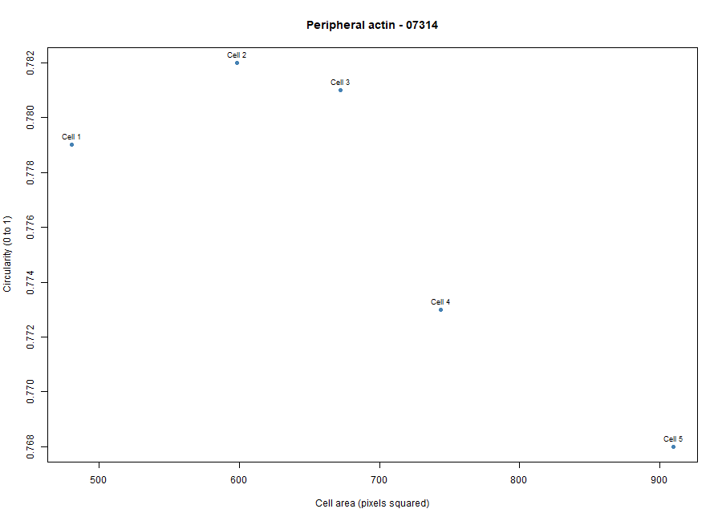
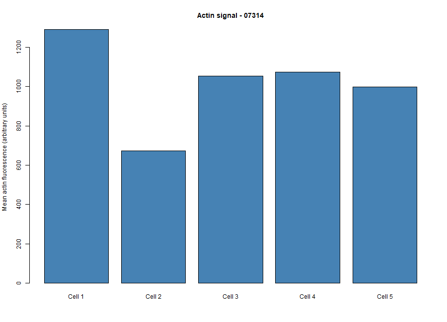

# Cytoskeleton and Cell Morphology Lab
## BBBC018 Fluorescence Image Analysis

### Student Information

- **Student ID:** 202400719
- **Chosen phenotype:** Peripheral actin
- **Image-field ID:** 07314
- **Actin filename:** 07314-actin.DIB
- **DNA filename:** 07314-DNA.DIB

### 1. Dataset and Image Selection

The fluorescence images used in this activity were obtained from the BBBC018v1 dataset, which contains images of fixed, stained HT29 human colon-cancer cells.

**Dataset source:** Broad Bioimage Benchmark Collection (BBBC018)

- Dataset page: https://bbbc.broadinstitute.org/BBBC018
- Direct download: https://data.broadinstitute.org/bbbc/BBBC018/BBBC018_v1_images.zip

The selected image field was **07314**. The phenotype selected was **Peripheral actin**, based on visual comparison of the actin staining pattern with the phenotype examples provided on the BBBC018 webpage.

The image filename identifies the image-field ID, not the phenotype. Therefore, the selected phenotype is a visual classification rather than a verified dataset annotation.

### 2. Methodology and Workflow

#### A. Image Selection and Preparation

1. Download the BBBC018v1 dataset from the BBBC018 webpage.
2. Extract the downloaded ZIP file to access the fluorescence images.
3. Locate the selected image field using its five-digit ID, 07314.
4. Open `07314-actin.DIB` in Fiji/ImageJ.
5. Open the matching DNA image, `07314-DNA.DIB`, from the same image field.
6. Compare the actin staining pattern with the phenotype examples on the BBBC018 webpage.
7. Select five intact and clearly outlined cells. Avoid cells touching the image edges or overlapping other cells.

#### B. Cell Measurement Using Fiji/ImageJ

1. Select **Analyze → Set Measurements**.
2. Check Area, Mean gray value, Shape descriptors, and Display label. Leave Limit to threshold unchecked.
3. Open **Analyze → Tools → ROI Manager**.
4. Use the Freehand Selection tool to trace the outer boundary of the first cell in the actin image. And use the DNA image as a guide.
5. Press **T** to add the selected region to ROI Manager.
6. Select **Analyze → Measure** or press **M** to record the measurements.
7. Repeat the procedure for all five cells.
8. Then check that the Results window contains five rows and the required columns: Area, Mean, Circ., AR. Round, and Solidity.
9. Save the Fiji Results as `data/measurements.csv`.
10. In ROI Manager, select **Show All** and save an annotated image or screenshot as `figures/measured_cells.png`.

#### C. Data Analysis Using RStudio

1. Create a laboratory folder with four subfolders: `data`, `scripts`, `results`, and `figures`.
2. Place `measurements.csv` inside the `data` folder.
3. Open RStudio and set the working directory to the main laboratory folder.
4. Create a new R script and save it as `scripts/analyze_cells.R`.
5. Use the analysis code provided in the laboratory instructions. Set the phenotype to `Peripheral actin`, the image ID to `07314`, and the input CSV filename to `measurements.csv`.
6. Run the entire script (you can also click source instead of directly clicking run).
7. Check the numerical summary saved in the `results` folder.
8. Check the two generated plots in the `figures` folder.

The R script calculates the mean cell area, circularity, aspect ratio, and actin fluorescence intensity of the five measured cells.

### 3. Results

Five cells were measured from image field 07314.

| Measurement | Mean result |
|---|---:|
| Cell area | 680.8 px² |
| Circularity | 0.7766 |
| Aspect ratio | 1.227 |
| Actin fluorescence intensity | 1018.451 |

#### Figure 1. Cell Area versus Circularity

This plot shows the relationship between the measured cell areas and circularity values. Circularity values closer to 1 indicate rounder cell shapes.

#### Figure 2. Relative Actin Signal of Measured Cells

This bar plot presents the mean actin fluorescence intensity of each of the five measured cells. Fluorescence intensity is expressed in arbitrary units.

### 4. Interpretation and Discussion

**1. Which specific phenotype did you choose, and what visible features support that choice?**

The selected phenotype was Peripheral actin. This classification was based on the visible actin staining pattern, which appeared concentrated along the outer regions or periphery of the cells. The image was compared with the phenotype examples provided on the BBBC018 webpage.

**2. Were your five cells mostly round or elongated? Refer to your circularity and aspect-ratio results.**

The five measured cells showed a moderately rounded shape, with a mean circularity of 0.7766. Their mean aspect ratio was 1.227, indicating some elongation rather than perfectly round shapes. Overall, the measurements suggest that the cells were not strongly elongated.

**3. What role does actin play in maintaining cell shape and in cell movement (Karp Chapter 9)?**

Actin is an important component of the cytoskeleton that helps maintain cell shape and provides structural support. It also contributes to cell movement through the rearrangement of actin filaments and the generation of forces that allow cells to change shape and move.

**4. Why can a single fixed fluorescence image NOT show how fast a cell moves?**

A fixed fluorescence image captures cells at only one particular moment. It does not show changes in cell position over time. Measuring movement speed requires observing living cells through time-lapse imaging or another method that records movement across multiple time points.

### Data Credit and References

We used image set BBBC018v1 from the Broad Bioimage Benchmark Collection (Ljosa et al., Nature Methods, 2012). 

Dataset page: https://bbbc.broadinstitute.org/BBBC018

The images are licensed under CC BY-NC-SA 3.0; retain attribution when sharing image-derived screenshots.
